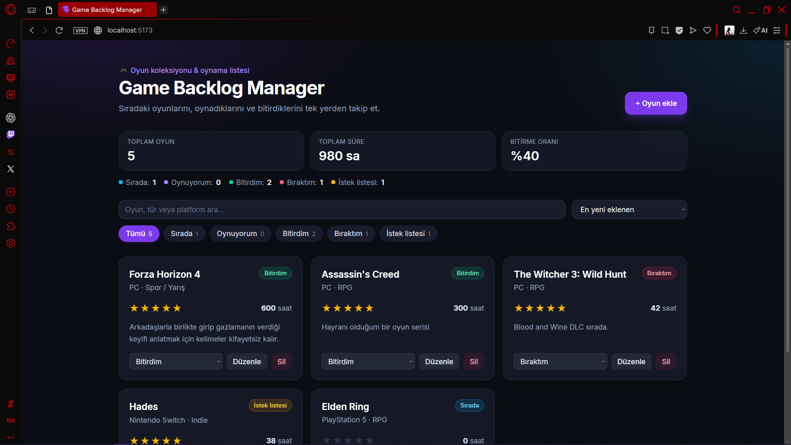

# 🎮 Game Backlog Manager

🌐 **Dil / Language:** [Türkçe](#-türkçe) · [English](#-english)

**Canlı demo / Live demo:** _https://app.netlify.com/teams/atay-mert-calicilar/projects_



---

# 🇹🇷 Türkçe

Oyun koleksiyonunu ve oynama listeni (backlog) tek yerden yönetmeni sağlayan, React ile yazılmış bir frontend uygulaması. Software Persona **Web Geliştirme; Javascript Proje Yönergesi** kapsamında hazırlanmıştır.

## Özellikler

| İşlem | Açıklama |
| --- | --- |
| **Ekle (Create)** | "+ Oyun ekle" ile ad, platform, tür, durum, puan, oynanan saat ve not girerek oyun ekle |
| **Listele (Read)** | Oyunlar kart görünümünde listelenir; istatistik özeti, arama, duruma göre filtre ve sıralama |
| **Güncelle (Update)** | "Düzenle" ile tüm alanları değiştir ya da karttaki menüden durumu hızlıca güncelle |
| **Sil (Delete)** | "Sil" ile onay penceresi üzerinden kalıcı olarak kaldır |

Ek olarak: toast bildirimleri, form doğrulama, responsive tasarım ve LocalStorage ile kalıcı veri (sayfa yenilense de kaybolmaz).

## Teknolojiler

- [React](https://react.dev/) + [Vite](https://vite.dev/)
- [Tailwind CSS v4](https://tailwindcss.com/)
- Tarayıcı **LocalStorage** (backend yok)
- Netlify ile yayın

## Klasör Yapısı

```
src/
├── Components/   # Yeniden kullanılabilir UI bileşenleri (GameCard, GameForm, Modal ...)
├── Pages/        # Sayfalar (LibraryPage)
├── Interfaces/   # Veri modeli (JSDoc tipleri) ve sabitler (durumlar, platformlar ...)
├── hooks/        # useLocalStorage, useGames (CRUD), useToast
├── App.jsx
└── main.jsx
```

## Kurulum

```bash
git clone <https://github.com/jawixa/Game-Backlog-Manager>
cd game-backlog-manager
npm install
npm run dev
```

Production build için:

```bash
npm run build
npm run preview
```

## Veri Modeli

```js
{
  id: string,
  title: string,
  platform: string,
  genre: string,
  status: 'backlog' | 'playing' | 'completed' | 'dropped' | 'wishlist',
  rating: 0-5,
  hoursPlayed: number,
  notes: string,
  createdAt: ISOString,
  updatedAt: ISOString
}
```

## Geliştirici

Hazırlayan: _Atay Mert Çalıcılar_

---

# 🇬🇧 English

A frontend app built with React that lets you manage your game collection and backlog in one place. It was created as part of the Software Persona **Web Development; JavaScript Project Guideline**.

## Features

| Operation | Description |
| --- | --- |
| **Create** | Click "+ Oyun ekle" (Add game) and enter title, platform, genre, status, rating, hours played and notes |
| **Read** | Games are shown as cards, with a stats summary, search, status filter and sorting |
| **Update** | Edit every field with the "Düzenle" (Edit) button, or quickly change the status from the dropdown on the card |
| **Delete** | Permanently remove a game via the "Sil" (Delete) button after confirming in a dialog |

Also included: toast notifications, form validation, responsive design, and persistent data via LocalStorage (your data survives page refreshes).

> Note: the app interface is in Turkish.

## Tech Stack

- [React](https://react.dev/) + [Vite](https://vite.dev/)
- [Tailwind CSS v4](https://tailwindcss.com/)
- Browser **LocalStorage** (no backend)
- Deployed on Netlify

## Project Structure

```
src/
├── Components/   # Reusable UI components (GameCard, GameForm, Modal ...)
├── Pages/        # Pages (LibraryPage)
├── Interfaces/   # Data model (JSDoc types) and constants (statuses, platforms ...)
├── hooks/        # useLocalStorage, useGames (CRUD), useToast
├── App.jsx
└── main.jsx
```

## Getting Started

```bash
git clone <https://github.com/jawixa/Game-Backlog-Manager>
cd game-backlog-manager
npm install
npm run dev
```

For a production build:

```bash
npm run build
npm run preview
```

## Data Model

```js
{
  id: string,
  title: string,
  platform: string,
  genre: string,
  status: 'backlog' | 'playing' | 'completed' | 'dropped' | 'wishlist',
  rating: 0-5,
  hoursPlayed: number,
  notes: string,
  createdAt: ISOString,
  updatedAt: ISOString
}
```

## Author

Created by: _Atay Mert Çalıcılar_
